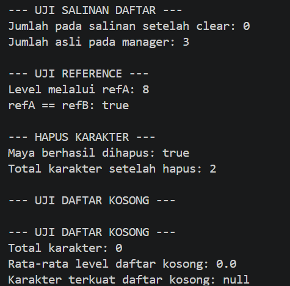

# Character Manager — TP5 (Java Visual SIH-6406)

**Nama:** [Purnama Sari]  
**NIM:** [253303621208]  
**Kelas:** [semester 3 pagi A]

## 1. Deskripsi Proyek

Character Manager adalah program berbasis Java untuk mengelola data karakter dengan menerapkan konsep Pemrograman Berorientasi Objek (PBO). Pada TP5, program dikembangkan dengan menambahkan fitur pengelolaan karakter, pencarian, penghapusan, serta pengujian perilaku object dan reference.

## 2. Fitur Baru TP5

- `addCharacter()` untuk menambahkan karakter dan menolak nama duplikat.
- `findByName()` untuk mencari karakter berdasarkan nama.
- `removeCharacter()` untuk menghapus karakter.
- `getTotalCharacters()` untuk menghitung jumlah karakter.
- `getAllCharacters()` untuk memperoleh daftar karakter.
- `getAverageLevel()` untuk menghitung rata-rata level, dengan hasil 0 jika daftar kosong.
- `findByType()` untuk mencari karakter berdasarkan tipe.
- `equals()` dan `hashCode()` untuk mendukung perbandingan karakter berdasarkan nama secara konsisten.
- Eksperimen defensive copy untuk memeriksa apakah perubahan pada salinan daftar memengaruhi daftar asli.

## 3. Screenshot Output CRUD

Screenshot hasil program disimpan pada folder `screenshot/`.

### 3.1 Pengujian CRUD

![Screenshot/output_tp05.png]

Screenshot ini memperlihatkan hasil pengujian penambahan karakter, pencarian karakter, penghapusan karakter, dan penghitungan jumlah karakter.

### 3.2 Eksperimen Reference

]

Screenshot ini memperlihatkan hasil eksperimen reference atau defensive copy untuk mengamati perbedaan antara daftar asli dan salinannya.

## 4. Penjelasan Bagian C

Bagian C membahas pengembangan dan pengujian fitur Character Manager. Pengujian CRUD digunakan untuk memastikan data karakter dapat ditambahkan, dicari, dihapus, dan dihitung dengan benar. Pemeriksaan nama duplikat membantu mencegah data karakter dengan nama yang sama dimasukkan berulang kali.

Eksperimen reference digunakan untuk memahami bahwa beberapa variabel dapat merujuk pada object yang sama. Defensive copy membantu melindungi koleksi internal agar perubahan pada daftar yang diberikan kepada pengguna tidak langsung mengubah data internal. Pengujian tambahan dilakukan pada pencarian berdasarkan tipe, rata-rata level, serta perbandingan karakter.

## 5. Struktur Folder

```text
CharacterManager_/
├── src/
│   └── com/unpri/charactermanager/
│       ├── Main.java
│       └── model/
│           ├── Character.java
│           ├── CharacterType.java
│           └── CharacterManager.java
├── screenshots/
│   ├── output-crud.png
│   └── eksperimen-reference.png
└── README.md
```

## 6. Google Docs — Bagian D

Dokumen laporan Bagian D berisi penjelasan dan analisis sesuai instruksi tugas TP5.

**Link Google Docs:** [https://1drv.ms/w/c/EF681E4F4E3CE288/IQA4FnerNc4XQYRnqw-o7hjPAVMCIdGQ8HeboFBjTKYvF40?e=7jOjEw]

Pastikan akses dokumen diatur menjadi *Anyone with the link — Viewer*.

## 7. Kesimpulan

Melalui TP5, proyek Character Manager dikembangkan dengan fitur pengelolaan karakter dan pengujian perilaku object. Tugas ini juga membantu memahami pengelolaan koleksi, encapsulation, reference, defensive copy, serta penggunaan Git dan GitHub untuk menyimpan riwayat pengembangan program.


--------
## TP8 — Character Manager Sprint #3

### 1. Deskripsi

Pada TP8, proyek Character Manager dikembangkan
dari aplikasi berbasis console menjadi aplikasi
GUI menggunakan Java Swing.

Aplikasi menampilkan daftar karakter secara dinamis,
informasi level, HP, attack, mana, serta statistik
rata-rata level.

Aplikasi juga memiliki fitur untuk menambahkan
karakter baru melalui formulir GUI.

### 2. Screenshot Aplikasi

#### Sebelum Penambahan Karakter


#### Sesudah Penambahan Karakter


### 3. Alur Data dan MVC

Main.java membuat objek Character dan mengatur
level serta mana setiap karakter. Selanjutnya,
CharacterManager menyimpan dan mengelola daftar
karakter serta menyediakan method untuk mengambil
data dan menghitung rata-rata level.

MainWindow berperan sebagai View yang mengambil
data dari CharacterManager dan menampilkannya
melalui JLabel secara dinamis. Ketika pengguna
menambahkan karakter melalui formulir GUI,
MainWindow meminta CharacterManager menyimpan
karakter tersebut, kemudian memperbarui tampilan
dan statistik.

Dalam konsep MVC, Character dan CharacterManager
berperan sebagai Model, sedangkan MainWindow
berperan sebagai View. Pada implementasi ini,
belum ada Controller terpisah.

### 4. Karakter Baru

- Sinta — MAGE, Level 4, Mana 40.
  Dipilih sebagai karakter penyihir dengan level
  menengah dan mana yang cukup tinggi.

- Damar — WARRIOR, Level 6, Mana 25.
  Dipilih sebagai karakter petarung dengan level
  lebih tinggi daripada karakter pemula.

### 5. Analisis GUI dan MVC

Dokumen analisis Google Docs:

[https://1drv.ms/w/c/EF681E4F4E3CE288/IQCVjYgbhaBeRrGWPrY4-RD8ASXF7lKziWi85TCA0ig1Hl8?e=nGYvXl]
